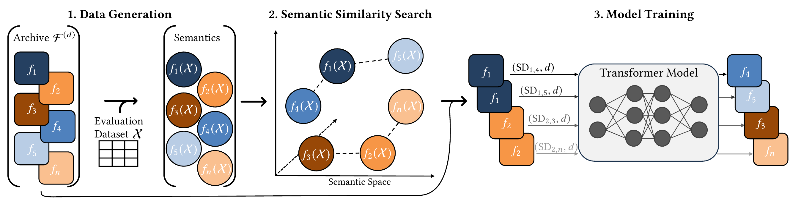

# Transformer Semantic Genetic Programming

<p align="center">
  <a href="https://github.com/Giganth/transformer_semantic_gp/blob/main/LICENSE"></a>
  <a href="https://dl.acm.org/doi/abs/10.1145/3712256.3726412"></a>
  <a href="https://arxiv.org/abs/2511.09416"></a>
</p>
Transformer Semantic Genetic Programming (TSGP) is a semantic GP approach that uses a pre-trained
transformer model as a variation operator to generate offspring programs with high semantic similarity
to a given parent. Unlike other semantic GP approaches that rely on fixed syntactic transformations, TSGP
learns diverse structural variations that lead to offspring with similar semantics.

## Installation
```bash
# Create a virtual environment
python3.12 -m venv venv

# Activate (Linux/macOS)
source venv/bin/activate

# Optional: upgrade pip
python -m pip install --upgrade pip

# Install the package
pip install -e .
```

## Quick Start

**Standard GP:**
```bash
./venv/bin/python examples/symbolic_regression.py --algorithm standard_gp
```

**Transformer GP:**
```bash
./venv/bin/python examples/symbolic_regression.py --algorithm transformer_gp
```
## Key Features

- **Semantic-aware variation** using a transformer model
- **FAISS-based similarity search** for nearest neighbor selection
- **Pre-trained weights** for TSGP (`src/TSGP/transformer/models/TSGP.weights.h5`).
- **Configurable experiments** via YAML files

## Project Structure

```
src/TSGP/
├── algorithms/          # Variation Operators of Standard GP and Transformer GP 
├── transformer/         # Transformer model, pretraining, and similarity search
├── core/                # Evolutionary search (engine.py) & core functionalities
├── symbolic_regression/ # Dataset loading, evaluation, and benchmark datasets
└── experiments/         # Batch experiment management (initialize, run, analyze)

examples/              # Example scripts and configs
experiments_data/      # Generated archives, logs, and experiment outputs

```

## Requirements

- Python ≥3.10, ≤3.13 (tested on 3.10)
- TensorFlow ≥2.8 (with CUDA support)
- FAISS, DEAP, NumPy, Pandas, scikit-learn

See [`pyproject.toml`](pyproject.toml) or [`requirements.txt`](requirements.txt) for complete dependencies with exact versions.

## Running Experiments

📖 **[Experiments Guide](examples/EXPERIMENTS_GUIDE.md)** - Detailed instructions for:
- Running single experiments for quick testing
- Setting up batch experiments with multiple runs
- Parallel execution on clusters using taskspooler
- Analyzing and visualizing results

## Model Building
The repository includes pre-trained transformer weights (`TSGP.weights.h5`). The training data used to train the transformer is available on [Figshare](https://figshare.com/s/a5a941c06dcd547f877f). To train your own model, follow the comprehensive guide:

<p align="center">
  <a href="misc/TSGP_Model_Building.pdf">
    
  </a>
</p>

📖 **[Model Building Guide](examples/MODEL_BUILDING_GUIDE.md)** - Complete walkthrough of:
1. **Data Generation** - Generate training data using evolutionary search
2. **Semantic Similarity Search** - Build similarity mappings between expressions
3. **Pretraining** - Train the Transformer model on the generated data

## Configuration

Edit YAML files in `examples/` to customize:
- Algorithm settings: Population size, generations, selection methods
- Variation operators: Crossover/mutation rates, transformer semantic variation (e.g. target semantic distance)
- Transformer architecture: Layers, attention heads, embedding dimensions
- Dataset selection: Choose from built-in benchmarks or add custom datasets


## Citation
If you use TSGP in your research, please cite:

```bibtex
@inproceedings{anthes2025transformer,
  title={Transformer Semantic Genetic Programming for Symbolic Regression},
  author={Anthes, Philipp and Sobania, Dominik and Rothlauf, Franz},
  booktitle={Proceedings of the Genetic and Evolutionary Computation Conference},
  pages={952--960},
  year={2025}
}
```

> **Note:** This repository is based on the latest paper (Anthes et al., 2025, arXiv:2511.09416). The codebase has been completely refactored and a new improved transformer model is trained, so results may diverge slightly from those reported in the paper. If you want to use the model used for the experiments, activate 'legacy_mode' and download the model here: https://figshare.com/s/a5a941c06dcd547f877f.

This repository is based on DEAP. Please also cite:

```bibtex
@article{DEAP_JMLR2012,
    author    = " F\'elix-Antoine Fortin and Fran\c{c}ois-Michel {De Rainville} and Marc-Andr\'e Gardner and Marc Parizeau and Christian Gagn\'e ",
    title     = { {DEAP}: Evolutionary Algorithms Made Easy },
    pages     = { 2171--2175 },
    volume    = { 13 },
    month     = { jul },
    year      = { 2012 },
    journal   = { Journal of Machine Learning Research }
}
```